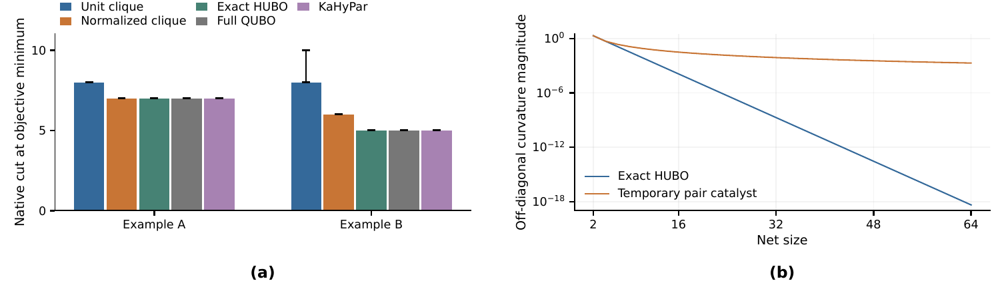
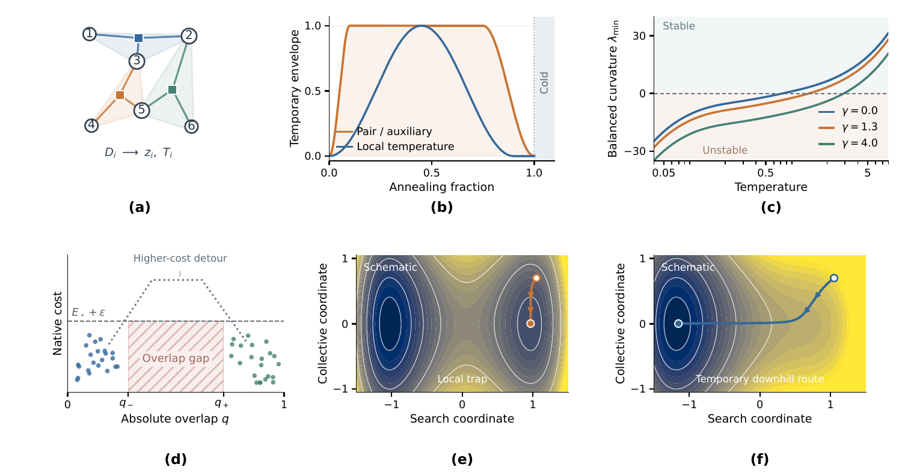

# qubo-hypergraph-partition

Two-way hypergraph partitioning through an exact cut-net **QUBO**, with a
portable Free-Energy Machine (FEM) reference and an optional compiled catalyst
engine. The solver starts from the original incidence structure and random
fields. KaHyPar provides independent comparison results; it does not initialize
the search.



For a net with size `r` and vertex count `k`, two binary auxiliaries give
`min[u,v] {1 + (r−1−k)u + (k−1)v} = 1[0<k<r]`. A quadratic count penalty,
with bounded slack bits for allowed imbalance, enforces capacity at global
minima. The heuristic may return an infeasible candidate; the output always
reports its actual cut, block sizes, imbalance and feasibility.



The overlap-gap illustration describes separated families of low-cost
solutions. The landscape panels illustrate temporary path deformation; they
are not measurements of a benchmark's energy surface or proof of an OGP
bypass. The native prototype restores the original QUBO at its endpoint.
This is quantum-inspired classical computation; a CUDA run is not quantum
hardware execution.

## Install and run

```bash
python -m pip install .
fem-hypergraph examples/tiny.hgr --steps 1000 --epsilon .03
```

```python
from fem_hypergraph_partition import Hypergraph, partition

graph = Hypergraph.read_hgr("examples/tiny.hgr")
result = partition(graph, steps=1000, backend="reference")
print(result["cut"], result["observed_imbalance_percent"], result["feasible"])
```

The public reference uses NumPy on CPU, independent Bernoulli distributions,
exponential temperature annealing and Adam. It is an inspectable baseline,
not the backend used for the manuscript's best results. Inputs currently
support unweighted `.hgr` format 0, two blocks and unweighted vertices.

## Compiled engine

Install a supplied native wheel matching your Linux architecture and CPython
version, then install its Torch/SciPy runtime dependencies:

```bash
python -m pip install 'fem-hypergraph-partition[native] @ file:///absolute/path/to/matching.whl'
fem-hypergraph examples/tiny.hgr --backend native --device cuda --steps 12000
```

The optional backend retains the catalyst portfolio, sparse incidence
operations, manual updates and CUDA Graph replay inside compiled extension
modules. It uses 48 replicas. The SM80 preview compiles fused FP64 implicit
updates, auxiliary responses and sparse incidence products ahead of time; it
uses the same CUDA Graph replay and avoids runtime kernel compilation. The
CPU preview uses Torch operations. The imbalance band uses a conservative
numerical safeguard. Validation compares original-graph random fields, cut,
measured imbalance and timing with the development implementation. The full
30-instance manuscript protocol remains a separate research benchmark.
A small graph must contain
enough cut-active vertices to construct four modes; use the reference backend
otherwise. An unavailable native backend raises an explicit error.

Public Python files implement I/O, scoring and the reference solver. The
compiled engine does not ship its Python/Cython/C++/CUDA source. Compilation
raises the cost of recovering implementation details; it does not guarantee
secrecy or make reverse engineering impossible.

## Validation

```bash
python -m pip install '.[test]'
python -m pytest -q tests
```

These tests enumerate small QUBOs, check auxiliary minimization and capacity,
and independently recompute returned cut and imbalance. The research protocol
also compares cuts and whole-pipeline times with KaHyPar at matching imbalance
settings. Faster primitive kernels alone establish neither a better optimizer
nor a way around an overlap gap.

## Licence

This software is available under the
[PolyForm Noncommercial License 1.0.0](LICENSE). Commercial use requires a
separate licence. For commercial licensing, contact **byao@connect.ust.hk**.
The terms of `LICENSE` control what constitutes a permitted purpose.
This is a source-available noncommercial release, not an OSI open-source
licence. Third-party software retains its own terms; see [NOTICE](NOTICE).

Normal graph Ising partitioning is maintained separately on the
`hybird-ising-partition` branch.
